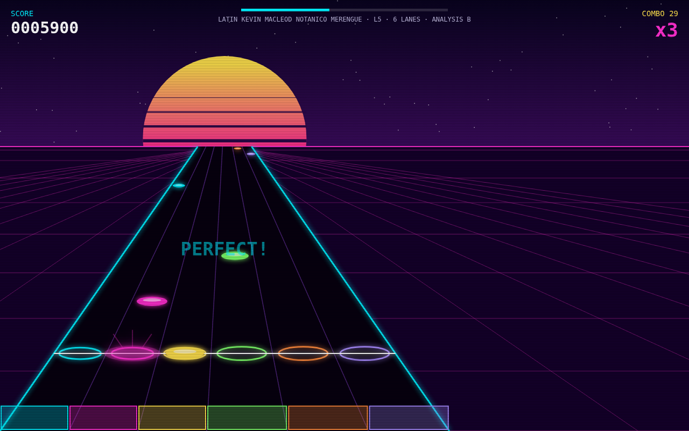
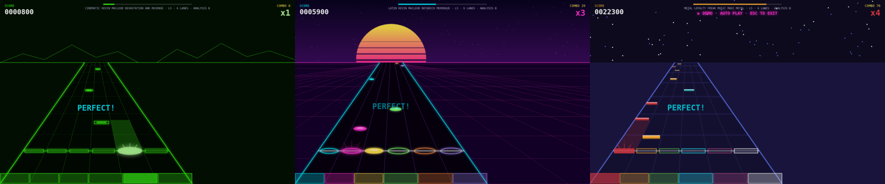
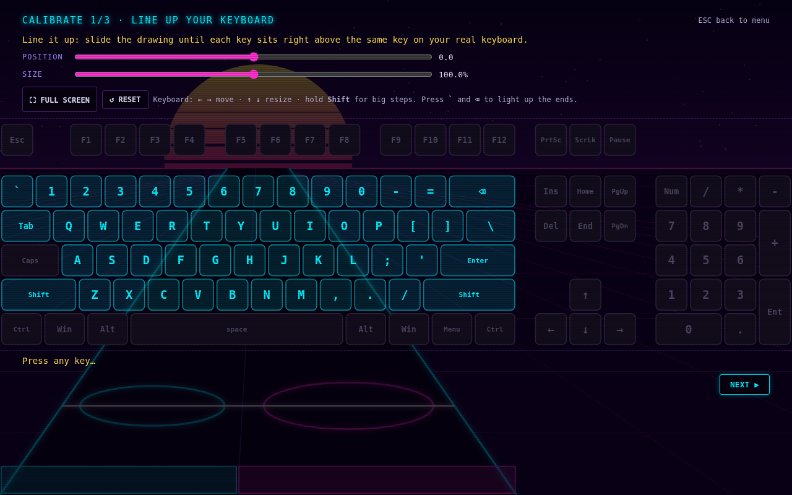
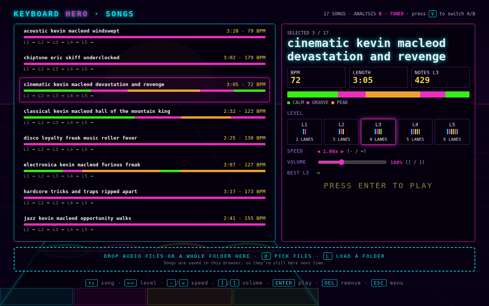
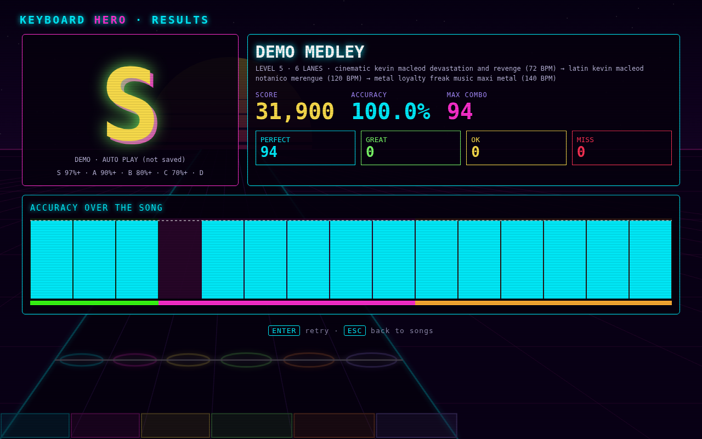

# Keyboard Hero

A retro rhythm game you play on your computer keyboard. Load any song: the game finds the beat and builds note charts at five levels. The lanes on the highway are slices of your real keyboard, lined up with the keys under the screen. The look follows the music: calm parts are green vector lines, groove parts are a neon sunset, and the loudest parts turn 8-bit.

It's a single HTML file with no install, no server and no internet connection needed.





## What you need

- **Chrome or Chromium** on a desktop computer. Other browsers are untested.
- **A full-size US (ANSI) keyboard**, the kind with a numpad. The lanes are drawn for that layout. Other keyboards may work, but the drawing won't match them.
- Speakers or headphones.

## How to play

### 1. Get the game

```sh
git clone https://github.com/Xteom/keyboard_hero.git
```

Or use **Code → Download ZIP** on GitHub and unzip it. Then open `keyboard_hero.html` in Chrome by double-clicking it or dragging it onto a Chrome window.

### 2. Calibrate (first launch only)

The game opens a 3-step setup the first time. You can redo it any time from **CALIBRATE** in the menu.

1. **Line up the keyboard.** Go full screen, then slide the drawing until each key sits right above the same key on your real keyboard. Use ← → to move it and ↑ ↓ to resize it, and hold Shift for bigger steps.
2. **Test the lanes.** Press keys to see which lane each one hits. Click a key to switch it off if you keep hitting it by accident.
3. **Check your timing.** Tap along with 12 clicks. The game measures your delay and corrects for it.



### 3. Load songs

On the **SONGS** screen, press **L** and choose the `songs/` folder from this repo. You can also press **O** to pick single files, or drag files or a whole folder onto the window. Your own MP3, OGG, WAV, FLAC and M4A files work too.

Each song is analyzed in the browser the first time (all 17 included songs take about 25 seconds). Songs and results are saved in the browser, so they're still there next time.



### 4. Play

Pick a song with ↑ ↓ and a level with ← →, then press **Enter**.

- Notes slide down the highway. Press **any key in that note's lane** when the note reaches the line.
- Lanes are vertical slices of the main block of keys, from the number row down to the Z row. Level 1 has 2 lanes (left hand and right hand) and level 5 has 6.
- Hits are judged as **Perfect** (within 45 ms), **Great** (90 ms) or **OK** (135 ms), and anything further off is a miss. Every 10 hits in a row raise your multiplier, up to x4.
- Grades are **S** at 97% accuracy, **A** at 90%, **B** at 80% and **C** at 70%. Anything lower is **D**.

Pick **DEMO** in the menu to watch a 30-second auto-played medley of the three styles (load the songs first).



## Controls

| Where | Key | Action |
|---|---|---|
| Menu | ↑ ↓, Enter | Choose, select |
| Menu | F | Full screen |
| Songs | ↑ ↓ | Choose a song |
| Songs | ← → | Choose a level (L1–L5) |
| Songs | `-` / `=` | Note speed (0.75x–1.5x) |
| Songs | `[` / `]` | Volume (up to 300%) |
| Songs | O / L | Add files / add a folder |
| Songs | V | Switch beat analyzer (B, the tuned one, is the default) |
| Songs | Del | Remove a song |
| Playing | Esc | Pause (Resume, Restart, Quit, Volume) |
| Results | Enter / Esc | Retry / back to songs |

The game also pauses if you switch windows or leave full screen, and counts down 3-2-1 before resuming.

## Music

The `songs/` folder has 17 tracks. Fourteen are free music under CC0 or CC BY 4.0, by Kevin MacLeod (incompetech.com), Eric Skiff, Loyalty Freak Music, Joth and Tricks & Traps. The other three power-metal tracks were made for this project. Full credits, licenses and source links are in [`songs/CREDITS.md`](songs/CREDITS.md).

## What's in the repo

| Path | What it is |
|---|---|
| `keyboard_hero.html` | The whole game |
| `songs/` | Songs to play, with credits |
| `songgen/` | Python scripts that generated the three original power-metal songs |
| `tools/` | Beat-analyzer tuning harness and a headless-Chrome test driver |
| `docs/` | Design spec, early mockups and README screenshots |
